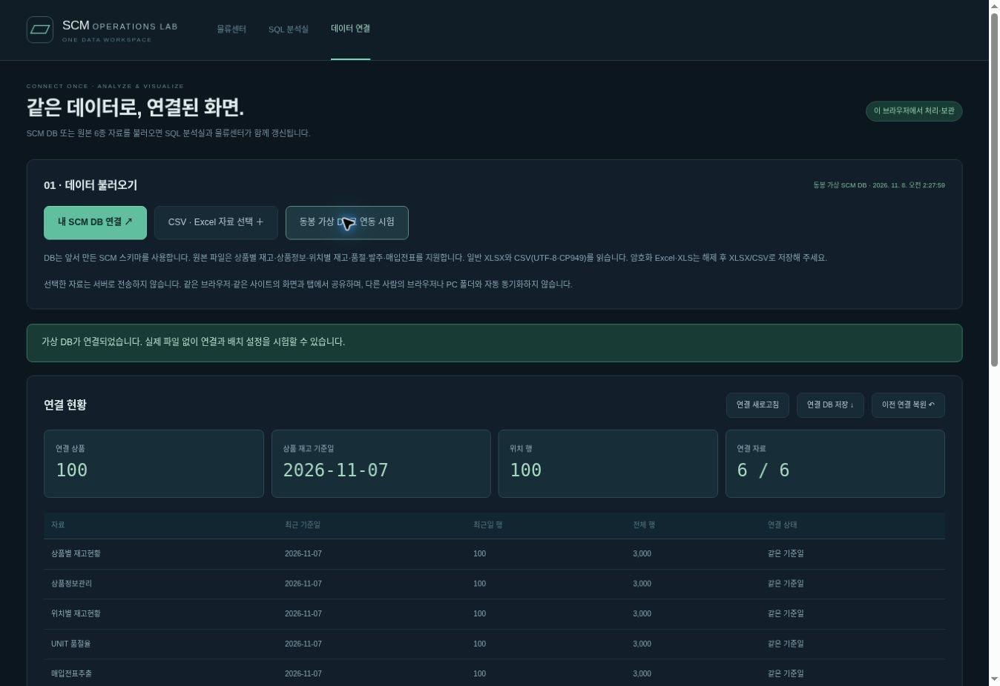
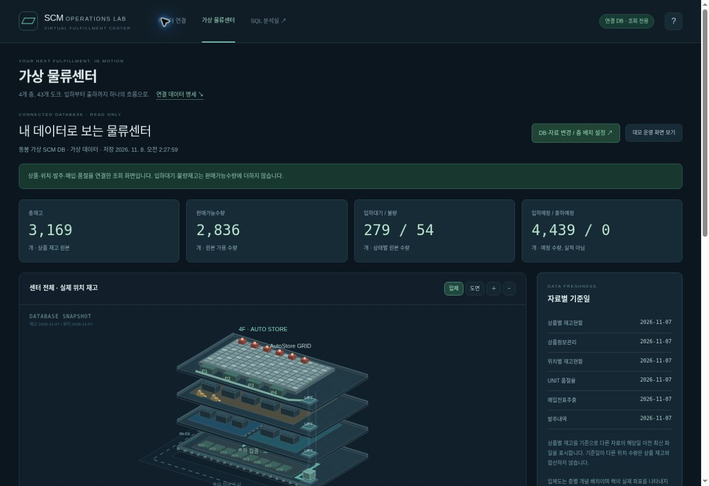
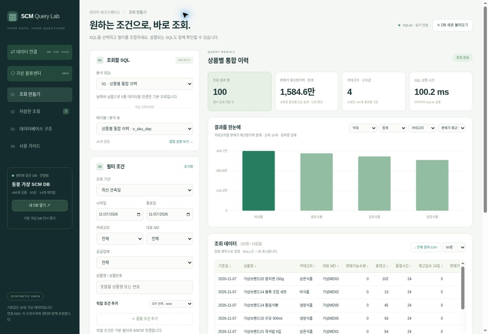

# SCM 웹사이트 사용 매뉴얼

작성일 2026-11-08 · 배포 버전 4 기준

SCM OPERATIONS LAB

웹사이트 사용 매뉴얼

DB 연결 · SQL 분석 · 가상 물류센터

실제 버튼 이름을 따라 파일을 연결하고, 재고를 조회하고, 층별 배치를 확인하는 운영 안내서입니다.

> 처음이라면 2쪽의 DB 연결 순서부터 시작하세요. DB가 없으면 3쪽의 CSV·Excel 경로를 사용합니다. 실제 자료 조회와 데모 운영은 별도 상태입니다.

| 메뉴 | 하는 일 | 페이지 |
| --- | --- | --- |
| 데이터 연결 | 내 DB / 원본 6종 적재, 층 배치, 백업·복원 | 2-5, 10 |
| SQL 분석실 | SQL 선택, 필터, 집계, 차트, CSV | 7-8 |
| 가상 물류센터 | 연결 데이터 조회 또는 독립 데모 운영 | 6, 9 |
| 오류·제한 / 소스코드 | 문제 해결, 구현 범위, 로컬 실행 | 11-12 |

바로 열기

데이터 연결 화면 열기  /  SQL 분석실 열기  /  물류센터 열기

이 매뉴얼의 기준

작성일 2026-11-08 · 매뉴얼 v1.0 · 배포 버전 4 기준. 센터 제목의 숫자 03은 화면 내부 표시이므로 배포 버전과 다를 수 있습니다. 화면 예시는 동봉 가상 데이터이며 실제 회사 자료가 아닙니다.

현재 서비스는 한 센터의 파일 기반 스냅샷을 읽는 웹 앱입니다. 웹사이트 주소는 공유할 수 있지만, 연결한 자료는 같은 브라우저 프로필 안에서만 사용합니다.

USER GUIDE / 01

내 DB로 시작하기

이미 만들어 둔 scm.db가 있을 때 사용하는 가장 짧은 경로입니다.

## 내 DB로 시작하기

01  데이터 연결 메뉴를 엽니다.상단의 데이터 연결 또는 위 링크를 사용합니다.

02  내 SCM DB 연결을 누릅니다.앞서 만든 구조의 .db / .sqlite / .sqlite3 파일을 선택합니다. DB는 100MB 이하입니다.

03  연결 현황을 확인합니다.상품 수, 상품 재고 기준일, 위치 행 수, 연결 자료 수(최대 6종)를 확인합니다. 표시되는 상품 수는 현재 기준일의 연결 가능한 상품 수입니다.

04  층 배치와 화면을 확인합니다.실제 로케이션의 가상 층·보관 구역을 설정한 뒤 물류센터와 SQL 분석실을 엽니다. 같은 브라우저의 이미 열린 탭도 갱신됩니다.

> 아무 SQLite DB나 자동 해석하는 기능은 아닙니다. 앞서 만든 SCM 스키마가 필요합니다. 호환되지 않으면 3쪽의 원본 CSV·Excel 경로를 사용하거나 별도 매핑을 개발해야 합니다.

USER GUIDE / 02

CSV·Excel로 원장 만들기

DB가 없거나 일별 원본 자료를 추가할 때 사용합니다.

## CSV·Excel로 원장 만들기

01  CSV · Excel 자료 선택을 누릅니다.여러 CSV를 함께 선택하거나, 여러 시트가 든 XLSX를 선택합니다. CSV는 UTF-8·CP949를 지원합니다.

02  자료 유형과 헤더 행을 확인합니다.파일/시트별로 상품별 재고, 상품정보, 위치 재고, 품절, 매입전표, 발주 유형을 지정합니다. 헤더는 첫 20행 범위에서 확인할 수 있습니다.

03  파일 기준일을 확인합니다.파일명에 날짜가 있으면 제안되며, 없으면 한국 날짜가 기본값입니다. 이것은 수집 스냅샷 날짜입니다. 전표의 매입일이나 입점예정일과 구분하세요.

04  처음에는 새 원장 만들기를 선택합니다.기존 연결은 이전 연결로 보관합니다. 기존 원장에 다음 날 자료를 쌓으려면 현재 원장에 날짜별 추가를 선택합니다.

05  검사 후 연결 반영을 누릅니다.처리 완료 메시지와 연결 현황을 확인합니다. 파일 하나에서 오류가 나면 이번 적재 전체가 롤백됩니다.

| 선택 상황 | 사용할 설정 |
| --- | --- |
| 처음 실제 자료를 넣음 | 새 원장 만들기. 동봉 가상 DB에 실제 자료를 덧붙일 수 없습니다. |
| 다음 날 자료를 추가함 | 현재 원장에 날짜별 추가 + 정확한 파일 기준일 |
| 같은 날짜의 수정 파일 | 교체 옵션을 명시적으로 체크. 기존 업무 행을 새 파일로 교체합니다. |
| 내용이 같은 파일을 다시 선택함 | 동일 유형·기준일·해시는 건너뜁니다. 행이 중복 추가되지 않습니다. |

> 처음에는 일부 자료만 연결할 수도 있습니다. 다만 없는 자료의 MD·품절·발주 정보는 자동 생성하지 않습니다. 필수 칼럼 오류는 유형·헤더를 고친 뒤 다시 반영하세요.

USER GUIDE / 03

원본 자료와 연결키

보내주신 249개 원본 칼럼 사전을 사용합니다. 아래는 적재에 필요한 최소 항목입니다.

## 원본 자료와 연결키

| 자료 | 필수 칼럼 / 연결키 |
| --- | --- |
| 상품별 재고현황 | 오프라인상품번호, 총재고, 판매가능수량 |
| 상품정보관리 | 오프라인상품번호, 상품명 |
| 위치별 재고현황 | 위치재고, 보관위치(셀), 오프라인상품ID 또는 물류상품ID. 물류상품ID만 있으면 상품 재고에서 상품번호를 연결할 수 있어야 합니다. |
| UNIT 품절율 | 오프라인상품번호, 품절시간수, 운영시간수 |
| 매입전표추출 | 오프라인상품번호, 전표번호, 매입수량 |
| 발주내역 | 오프라인상품번호, 발주, 입점예정일 |

값을 준비하는 방법

상품번호·바코드·물류상품ID는 텍스트로 보관하세요. 오프라인상품번호가 13자리 이하 숫자 문자열이면 13자리로 맞춥니다. 지수 표기 ID나 Excel의 16자리 이상 숫자 셀은 텍스트로 다시 저장해야 합니다.

빈칸은 NULL입니다. 숫자 해석에 실패한 값도 NULL과 점검 기록으로 보관합니다. 반복된 사용X 헤더는 순서대로 구분하고, 매핑하지 못한 칼럼도 원본 바이트·행과 점검 기록에 남깁니다.

| 항목 | 현재 지원 범위 |
| --- | --- |
| DB / 원본 파일 | DB 100MB 이하 / 원본 한 파일 30MB 이하 |
| 한 번에 선택하는 파일 합계 | 80MB 이하. 같은 유형·기준일 자료는 한 적재에 1개만 선택 |
| 행·칼럼 | 자료 1개 최대 25만 행. XLSX는 최대 500칼럼 |
| 파일 형식 | CSV·TSV·일반 XLSX. 암호화 Excel·XLS는 해제/변환 후 사용 |
| 센터 범위 | 단일 센터. 여러 센터 자료는 분리해 사용 |

USER GUIDE / 04

실제 로케이션을 층에 연결하기

데이터 연결 화면 아래의 03 · 실제 로케이션의 층·구역 연결을 사용합니다.

## 실제 로케이션을 층에 연결하기

01  원본 위치 그룹을 찾습니다.원본 창고 + 층 + 존 + 작업구역 조합으로 그룹이 표시됩니다. 그룹마다 원본 위치 행 수를 확인합니다.

02  가상 층을 선택합니다.1~4층 또는 미배정을 선택합니다. 처음에는 해석 가능한 원본 1~4층을 사용하고, 그 외는 미배정입니다.

03  가상 보관 구역을 선택합니다.냉동, 냉장, 대형, AutoStore, 기타/미분류를 지정하고 배치 설정 반영을 누릅니다.

| 원본 그룹의 예 | 설정할 가상 배치의 예 |
| --- | --- |
| 냉동 보관 구역 | 2층 / 냉동 |
| 냉장 보관 구역 | 2층 / 냉장 |
| 대형 상품 보관 구역 | 3층 / 대형 |
| AutoStore용 소형 상품 구역 | 4층 / AutoStore |

> 위 표는 가상센터의 계획 배치 예시입니다. 실제 원본 층이 자동으로 이 예시에 맞춰 재배치되지는 않습니다. 직접 그룹을 확인하고 설정하세요.

바뀌는 값과 보존되는 값

가상 층·보관 구역만 별도 매핑 테이블에 저장합니다. 원본의 창고·층·존·작업구역·보관위치·용기 ID는 그대로 남습니다. 설정을 반영하면 SQL 분석실과 센터가 바뀐 연결 DB를 읽습니다.

센터의 위치별 재고 명세에서는 가상 층/구역과 원본 층/존을 함께 볼 수 있습니다. 층 미배정 또는 위치 코드 누락이 있으면 경고 건수를 확인하세요.

위치가 보이지 않을 때

위치 파일이 실제로 적재됐는지, 위치 자료 기준일이 맞는지, 위치 상품ID가 상품 재고의 ID와 연결되는지부터 확인합니다. 화면의 입체 랙은 개념 배치이며 원본 로케이션의 정확한 XY 좌표를 의미하지 않습니다.

USER GUIDE / 05

연결된 물류센터 읽기

연결 DB가 있으면 내 데이터로 보는 물류센터가 열립니다. 원본 재고 조회 모드입니다.

## 연결된 물류센터 읽기

| 보이는 수량 | 해석 |
| --- | --- |
| 총재고 / 판매가능수량 | 상품별 재고현황의 해당 칼럼을 각각 표시합니다. 두 값을 더하지 않습니다. |
| 입하대기 / 불량 | 원본 상태 수량입니다. 판매가능수량에 가산하지 않습니다. |
| 입하예정 / 출하예정 | 예정 수량이며 실제 입하·출하 실적이나 차량 수가 아닙니다. |
| 층 버튼의 위치 수량 | 연결 위치 파일의 행·수량입니다. 상품 총재고와 중복 합산하지 않습니다. |

아래 명세에서 상품 재고 / 위치별 재고 / 발주내역 / 매입·입하 자료 / 품절 자료를 선택합니다. 기준일·층·검색을 적용하고, 행을 누르면 원본 칼럼을 봅니다. 화면은 최대 200행, CSV는 조회 결과 전체를 저장합니다.

> 자료별 기준일을 먼저 읽으세요. 센터는 선택한 상품 재고 기준일 이하의 자료별 최신 파일을 표시합니다. 날짜가 다른 위치 재고는 상품 재고와 합산·대조하지 않습니다. SQL 통합 뷰는 날짜가 같은 자료끼리 연결하므로 보조 정보가 다르게 보일 수 있습니다.

USER GUIDE / 06

SQL 분석실 기본 사용

코드를 직접 입력하지 않고 SQL과 필터를 선택하는 조회 도구입니다.

## SQL 분석실 기본 사용

01  조회할 SQL을 선택합니다.처음에는 01 · 상품별 통합 이력을 선택합니다. 직접 테이블/뷰 선택으로 원본 테이블도 볼 수 있습니다.

02  필터 조건을 설정합니다.기간, 카테고리, 대표 MD, 공급업체, 상품명/번호를 설정합니다. 현재 결과 칼럼에 없는 필터는 비활성화됩니다.

03  칼럼·집계·정렬을 정합니다.칼럼 선택으로 출력 항목을 고릅니다. 상세 행 그대로 또는 날짜/카테고리별 집계를 선택합니다. 집계 기준은 최대 3개입니다.

04  조회 실행 후 저장·내보내기를 합니다.차트와 표를 확인하고 전체 결과 CSV를 저장합니다. 별표 저장은 DB가 아니라 조회 조건을 보관합니다.

직접 조건은 최대 12개입니다. 직접 조건끼리는 AND/OR를 선택할 수 있지만, 기본 필터와 직접 조건 그룹은 AND로 연결됩니다. SQL 표시 영역에서 실제 조회 SQL을 확인할 수 있습니다.

USER GUIDE / 07

SQL 선택과 해석 예시

질문을 먼저 정하고 적절한 SQL을 선택하세요. 결과는 조치 검토 신호이며 원인 확정이 아닙니다.

## SQL 선택과 해석 예시

| SQL 메뉴 | 확인할 질문 |
| --- | --- |
| 01 상품별 통합 이력 / 02 최신일 재고 전체 | 상품의 재고·상태·보조 정보를 연결해 보거나 최신일만 확인 |
| 03 최신일 품절 상품 / 04 입하대기 + 품절 | 품절이 기록된 상품과 가용화 대기 재고의 동시 발생 확인 |
| 05 조치 우선 검토 / 06 50일 이상 재고 추가 발주 | 조치 대상 또는 과재고 상태의 추가 발주 검토 |
| 07 비판매 상태의 재고 / 08 일별 품절·재고 KPI | 판매 상태와 재고 확인 또는 일별 추이 확인 |
| 09 공급업체 납품 성과 / 10 위치재고와 임박 수량 | 납품 충족 신호와 위치·임박 수량 확인 |
| 11 상품별 납품·매입 수량 / 12 DB 데이터 품질 검사 | 전표 수량 또는 연결·중복·숫자 오류 점검 |
| 13 원본 칼럼 사전 / 14 DB 적재 실행 기록 | 원본 칼럼·자료형 또는 적재 결과 확인 |

예시: 냉장 상품의 입하대기 품절 검토

04 · 입하대기 + 품절 → 카테고리 냉장식품 → 필요한 칼럼에 상품명·품절시간·입하대기·판매가능수량 표시 → 조회 실행. 실제 자료의 카테고리 명칭은 파일에 있는 값으로 선택합니다.

> 결과에 있다고 입하대기가 품절의 확정 원인인 것은 아닙니다. 일별 스냅샷만으로는 발생 선후 관계를 알 수 없습니다. 입하 검수·가용화 시점이나 주문 자료를 함께 확인해야 합니다.

집계에서 지킬 세 가지

① 날짜별 재고 합계는 현재 보유재고가 아닙니다. ② 비율은 단순 평균과 시간 가중 비율을 구분합니다. ③ 미리 집계된 SQL은 필터가 집계 후에 적용됩니다. 집계 전 MD·카테고리 필터가 필요하면 01 통합 이력에서 필터 후 집계하세요. SQL 결과는 최대 50,000행 범위로 조회합니다.

USER GUIDE / 08

데모 센터 운영하기

연결 화면의 데모 운영 화면 보기를 누릅니다. 실제 DB와 별개의 모의 상태입니다.

## 데모 센터 운영하기

| 층 | 계획 구역 / 데모 구성 |
| --- | --- |
| 1층 | 입하 도크 3개, 출하 도크 40개. 검수·패킹·집결 구역 |
| 2층 | 냉동 18개 위치 / 초기 360개, 냉장 12개 위치 / 초기 480개 |
| 3층 | 대형 상품 30개 위치 / 초기 230개 |
| 4층 | AutoStore. 초기 상품 재고 580개, 로봇 6대·포트 4개는 데모 값 |

01  운영 시작과 배속을 확인합니다.일시정지/운영 시작, ×1·×5·×20으로 모의 시간을 제어합니다. 숨겨진 탭에서는 진행이 멈춥니다.

02  데모 주문 10건 또는 입하 차량 1대를 추가합니다.초기 주문은 12건입니다. 자동 주문을 켜면 모의 시간 1분마다 3건이 추가됩니다. 최대 주문은 300건입니다.

03  작업 흐름과 도크를 확인합니다.주문은 재고 예약 → 피킹 → 1층 이송 → 패킹 → 노선별 상차 → 차량 출발로 진행합니다. 입하는 하역·검수 → 적치 → 가용화 순서입니다.

04  위치·주문·도크를 눌러 상세를 봅니다.빈 도크의 차량 배정·점검 전환, 출하 차량 출발 등을 시험할 수 있습니다. 상차 중에는 출발할 수 없습니다.

> 모의 보유 = 초기재고 + 적치완료 - 피킹완료. 모의 가용 = 보유 - 피킹 예약. 2·3층 초기 1,070개는 위치별로 분배한 값이며 상품 재고에 다시 더하지 않습니다. 센터 전체 초기 재고는 1,650개입니다.

데모 상태는 탭별로 보관하며 새로고침 후 일시정지로 복원됩니다. 초기화는 이 탭의 데모 상태를 되돌립니다. 상태 JSON은 내보내기용이며 현재 JSON 재불러오기 기능은 없습니다.

USER GUIDE / 09

매일 갱신·백업·복원하기

다음 날 자료를 넣는 절차와 브라우저 저장 범위를 정리합니다.

## 매일 갱신·백업·복원하기

| 순서 | 매일 확인할 일 |
| --- | --- |
| 1 | 자료의 센터·기준일·수집 시점을 확인합니다. DB를 갱신했다면 내 SCM DB 연결로 최신 파일을 다시 선택합니다. |
| 2 | 원본 파일을 쌓는 경우 CSV·Excel 선택 → 현재 원장에 날짜별 추가를 사용합니다. 같은 날짜 수정은 교체 옵션을 확인합니다. |
| 3 | 연결 현황 6종의 날짜·행 수, 중복·NULL·미배정·합계 불일치 기록을 확인합니다. |
| 4 | 센터와 SQL 분석실에서 기준일·총재고·판매가능수량을 비교합니다. |
| 5 | 연결 DB 저장으로 scm_connected.db를 저장합니다. 다음 연결 변경에 앞서 별도 보관합니다. |

연결 DB 저장과 이전 연결 복원

연결 DB 저장에는 업무 테이블뿐 아니라 적재한 원본 자료와 배치 설정도 포함됩니다. 이전 연결 복원은 직전 연결 한 개를 되돌리는 기능입니다. 변경을 반복하면 계속 과거로 돌아가는 다단계 이력 백업은 아닙니다.

다른 PC나 휴대폰에서 이어서 사용하려면

저장한 DB를 다른 장치에서 다시 연결합니다. 같은 브라우저라도 프로필·사이트 주소가 다르면 저장소가 다릅니다. 공개 사이트와 localhost에서 실행한 복사본도 별도 저장소를 사용합니다.

> 연결 새로고침은 브라우저에 저장된 연결 상태를 다시 읽습니다. PC 파일을 감시하거나 자동으로 가져오지 않습니다. 브라우저 데이터 삭제·시크릿 창 종료 등으로 연결이 사라질 수 있으므로 DB 파일을 보관하세요.

SQL 분석실의 기본 가상 DB 다시 열기는 연결을 동봉 가상 DB로 바꿀 수 있습니다. 실제 작업 중에는 목적을 확인하고 사용하세요. 공개 사이트에 접속한 다른 사람에게 내 연결 DB가 자동 공유되지는 않습니다.

USER GUIDE / 10

문제가 생겼을 때

메시지를 확인하고 원본과 연결 상태부터 점검합니다.

## 문제가 생겼을 때

| 증상 / 메시지 | 확인·해결 순서 |
| --- | --- |
| SCM DB 형식이 아님 | 앞서 만든 스키마인지 확인합니다. 다른 DB는 원본 파일 경로 또는 별도 변환이 필요합니다. |
| 필수 칼럼이 없음 | 자료 유형, 헤더 행, 원본 칼럼명을 확인합니다. 사용X 같은 반복 칼럼을 임의 삭제하지 않습니다. |
| ID가 지수 표기 / 긴 숫자 셀 | Excel에서 텍스트로 지정하고 원래 코드·선행 0을 복구한 파일로 다시 저장합니다. |
| 숫자 오류 / 값이 —로 보임 | NULL 여부와 점검 기록을 봅니다. 빈칸·잘못된 수량을 임의로 0으로 바꾸지 않습니다. |
| 같은 유형·기준일이 이미 있음 | 내용이 바뀐 파일인지 확인하고 교체 옵션을 선택합니다. 같은 해시는 건너뜁니다. |
| 다른 탭에서 데이터가 바뀜 | 연결 새로고침 후 현재 상태를 확인하고 반영을 다시 시도합니다. |
| 센터에서 상품·위치가 누락됨 | 상품 재고 기준일, 중복 키, 위치 상품ID, 층/코드 미배정을 확인합니다. |
| 위치 합계와 총재고가 다름 | 기준일·누락 위치·상품 연결키·원본 수량 정의를 확인합니다. 두 값을 더해 맞추지 않습니다. |
| 다른 장치에서 자료가 안 보임 | 브라우저별 저장입니다. 저장한 DB를 해당 장치에서 다시 연결합니다. |
| 파일이 큼 / 저장 실패 | 파일·DB 크기 제한과 브라우저 여유 공간을 확인합니다. 기존 연결을 저장한 뒤 파일을 나누어 적재합니다. |
| 수정한 PC 파일이 화면에 안 뜸 | 파일 감시 기능은 없습니다. 갱신된 파일을 다시 선택하세요. |
| SQL 결과가 0행 | 기간·필터·SQL 자체 조건을 확인합니다. 해당 조건의 데이터가 없으면 0행도 정상입니다. |

USER GUIDE / 11

현재 범위와 소스코드 안내

무엇을 해석할 수 있고, 어떤 기능은 추가 연동이 필요한지 구분합니다.

## 현재 범위와 소스코드 안내

| 현재 가능한 것 | 추가 개발·자료가 필요한 것 |
| --- | --- |
| 6종 파일 → SCM 원장 → SQL·센터 조회 | PC 폴더 자동 감시·매일 자동 업로드 |
| 브라우저 안 DB 보관·같은 사이트 탭 갱신 | 여러 사람·장치가 공유하는 중앙 DB |
| 층·보관존 매핑과 위치 재고 명세 | 실제 랙의 정확한 3D 좌표·설비 제어 |
| 일별 품절시간·재고·발주·매입 신호 검토 | 주문 시각 기반 손실·예측 정확도·원인 확정 |
| 독립 데모 주문·입하·피킹·출하 | 실제 고객 주문·차량·온도·WMS 실시간 연결 |

소스코드에서 찾을 파일

| 파일 | 역할 |
| --- | --- |
| dist/data-hub.js | 연결 DB 보관, 화면 간 갱신, 이전 연결 복원 |
| dist/data/import-core.js / data.js | CSV·Excel 적재 규칙 / 데이터 연결 화면 |
| dist/data/snapshot.js | 상품·위치·발주·매입·품절 연결과 배치 설정 |
| dist/query-core.js / app.js | SQL 조건 구성 / 분석실 화면 |
| dist/center/linked.js | 연결 DB를 읽는 물류센터 조회 화면 |
| dist/center/engine.js / scene.js | 독립 데모 처리 / 입체 개념 배치도 |

Windows에서 소스 실행

ZIP을 압축 해제하고 실행_로컬.bat를 실행한 뒤 브라우저에서 http://localhost:8000/data/ 를 엽니다. Python이 설치돼 있어야 합니다. HTML 파일을 더블클릭하는 file:// 방식 대신 로컬 HTTP 서버를 사용하세요. VS Code에서 수정할 수 있으며, 웹 실행에 npm 설치나 별도 DB 서버는 필요하지 않습니다.

웹 소스는 배포 버전 4의 스냅샷입니다. ZIP에는 로컬 실행 안내와 테스트의 경로 호환 보완을 함께 넣었습니다. 검증 기록과 구현 설명은 README.md 및 CENTER_README.md에서 확인할 수 있습니다.